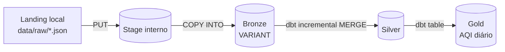

# Medallion no Snowflake — Qualidade do Ar

[](https://github.com/amanda-martins-data/snowflake-medallion-qualidade-ar/actions/workflows/ci.yml)

Arquitetura Medallion (**Bronze → Silver → Gold**) implementada de forma
nativa no **Snowflake** com **dbt**: ingestão via stage e `COPY INTO`,
Bronze em `VARIANT`, Silver incremental com `MERGE`, Gold com
classificação de **Índice de Qualidade do Ar (AQI)** e testes de dados
em todas as camadas.

É a versão em data warehouse na nuvem do
[Projeto 03](https://github.com/amanda-martins-data/arquitetura-medallion-qualidade-ar),
que faz o mesmo com Parquet e DuckDB. Parte do meu portfólio de
Engenharia e Arquitetura de Dados — veja o
[perfil completo](https://github.com/amanda-martins-data).

## Arquitetura



Decisões de arquitetura, testes de qualidade e comparação com a versão
local estão em [`docs/architecture.md`](docs/architecture.md).

## Stack

`Snowflake` · `dbt` · `Python` · `SQL` · `GitHub Actions`

## O que o projeto cobre

- **Ingestão nativa:** `PUT` para stage interno e `COPY INTO` idempotente
  pelos metadados de carga do Snowflake.
- **Schema-on-read:** Bronze em `VARIANT`, resistente a mudanças de
  schema na fonte (schema drift).
- **Transformação incremental:** Silver com `MERGE` por chave natural,
  `LATERAL FLATTEN` e deduplicação com `QUALIFY`.
- **Qualidade de dados:** freshness da fonte, unicidade, não nulos,
  valores aceitos e teste customizado de datas no futuro.
- **Segurança:** roles com menor privilégio (`LOADER`, `TRANSFORMER`) e
  autenticação por par de chaves, sem senha no código.
- **Custo:** warehouse XS com auto-suspend de 60 segundos.
- **CI:** GitHub Actions valida o Python e o projeto dbt a cada push.

## Estrutura

```
.
├── setup/01_setup.sql          # warehouse, database, schemas, roles, stage, tabela Bronze
├── src/
│   ├── generate_sample_data.py # dados sintéticos no formato da OpenAQ (sem API key)
│   ├── extract.py              # extração real da API OpenAQ (opcional)
│   ├── generate_keypair.py     # gera o par de chaves RSA para autenticação
│   ├── snowflake_conn.py       # conexão a partir de variáveis de ambiente
│   └── load_bronze.py          # PUT + COPY INTO na Bronze
├── dbt_project/
│   ├── models/sources.yml      # fonte Bronze + freshness
│   ├── models/silver/          # silver_air_quality (incremental, MERGE)
│   ├── models/gold/            # gold_air_quality_daily (agregado + AQI)
│   ├── macros/                 # schemas SILVER/GOLD sem prefixo
│   └── tests/                  # teste genérico e teste customizado
└── docs/architecture.md
```

## Como rodar

### 1. Conta e infraestrutura

1. Crie uma conta trial em [signup.snowflake.com](https://signup.snowflake.com).
2. No Snowsight, abra uma worksheet como `ACCOUNTADMIN` e rode
   `select current_user();` para ver seu usuário exatamente como o
   Snowflake o guarda. Troque `<SEU_USUARIO>` em
   [`setup/01_setup.sql`](setup/01_setup.sql) por esse valor, mantendo
   as aspas, e rode o script inteiro.

### 2. Autenticação por par de chaves

```bash
pip install -r requirements.txt
python src/generate_keypair.py --user SEU_USUARIO   # o mesmo valor de current_user()
```

O script cria `keys/snowflake_rsa_key.p8` (fora do Git) e imprime um
comando `alter user ... set rsa_public_key = '...'`. Cole e rode esse
comando no Snowsight como `ACCOUNTADMIN`.

### 3. Variáveis de ambiente

O identificador da conta (`ORGNAME-ACCOUNTNAME`) aparece no Snowsight,
no menu da sua conta (canto inferior esquerdo), nos detalhes da conta,
em **Account identifier**.

PowerShell (Windows):

```powershell
$env:SNOWFLAKE_ACCOUNT = "ORGNAME-ACCOUNTNAME"
$env:SNOWFLAKE_USER = "SEU_USUARIO"
$env:SNOWFLAKE_PRIVATE_KEY_PATH = "$PWD\keys\snowflake_rsa_key.p8"
```

Bash (macOS/Linux):

```bash
export SNOWFLAKE_ACCOUNT="ORGNAME-ACCOUNTNAME"
export SNOWFLAKE_USER="SEU_USUARIO"
export SNOWFLAKE_PRIVATE_KEY_PATH="$PWD/keys/snowflake_rsa_key.p8"
```

### 4. Pipeline

```bash
# Landing: dados sintéticos (ou src/extract.py com OPENAQ_API_KEY)
python src/generate_sample_data.py

# Bronze: PUT + COPY INTO
python src/load_bronze.py

# Silver + Gold + testes
cd dbt_project
cp profiles.yml.example profiles.yml
dbt debug --profiles-dir .            # confere a conexão
dbt source freshness --profiles-dir . # a Bronze foi carregada há pouco?
dbt build --profiles-dir .            # modelos + testes, em ordem de dependência
```

Rodar `load_bronze.py` e `dbt build` de novo sem dados novos não duplica
nada: o `COPY INTO` ignora arquivos já carregados e o `MERGE` da Silver
atualiza pela chave natural.

### 5. Consultar o resultado

```sql
select city, measured_date, avg_value, aqi_category_pm25
from air_quality.gold.gold_air_quality_daily
where parameter = 'pm25'
order by measured_date desc, city;
```
