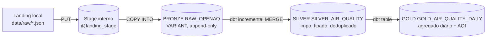

# Arquitetura — Medallion no Snowflake

## Visão geral

Mesma fonte e mesma lógica de negócio do
[Projeto 03](https://github.com/amanda-martins-data/arquitetura-medallion-qualidade-ar)
(Parquet + DuckDB), agora implementadas de forma nativa num data warehouse
em nuvem. O objetivo é comparar as duas abordagens e mostrar o que muda
quando o motor deixa de ser local e passa a ser gerenciado.

## Decisões e trade-offs

### 1. Ingestão com PUT + COPY INTO, e não com INSERT via Python
O script Python só move arquivos para o stage; quem carrega é o próprio
Snowflake, com `COPY INTO`. Isso mantém o trabalho pesado no warehouse e
dá idempotência de graça: o Snowflake guarda metadados de carga por
arquivo, então reenviar os mesmos arquivos não duplica a Bronze.

### 2. Bronze em VARIANT (schema-on-read)
A Bronze guarda o payload JSON inteiro numa coluna `VARIANT`, mais
metadados de origem (`_source_file`, `_loaded_at`). Se a API mudar de
formato ou ganhar campos (schema drift), a ingestão não quebra: o dado
chega intacto e a adaptação acontece em um só lugar, o modelo Silver.

### 3. Silver incremental com MERGE
`silver_air_quality` é `incremental` com estratégia `merge` e chave
natural `(location_id, parameter, measured_at_utc)`:
- cada execução lê só as linhas da Bronze com `_loaded_at` mais recente
  que a última carga, em vez de reprocessar o histórico inteiro;
- duplicatas dentro do lote são resolvidas com `QUALIFY ROW_NUMBER()`,
  ficando a extração mais recente;
- uma medição reenviada atualiza a linha existente em vez de duplicar;
- `on_schema_change = append_new_columns` permite evoluir o modelo sem
  recriar a tabela.

### 4. `TRY_CAST` em vez de `CAST` na tipagem
Um valor fora do formato esperado vira `NULL` e é filtrado pelas regras
de qualidade, em vez de derrubar o pipeline inteiro por causa de uma
única linha ruim.

### 5. Menor privilégio com duas roles
- `LOADER` só escreve na Bronze.
- `TRANSFORMER` só lê a Bronze e escreve em Silver e Gold.

Um erro no dbt não consegue apagar dado bruto, e uma falha na ingestão
não consegue alterar as camadas de consumo.

### 6. Custo sob controle
Warehouse `XSMALL` com `auto_suspend = 60`: o compute desliga após um
minuto ocioso. Para o volume deste projeto, o consumo fica em frações de
crédito por execução.

### 7. Autenticação por par de chaves
Nenhuma senha no código nem no repositório. Scripts e dbt leem conta,
usuário e caminho da chave privada de variáveis de ambiente, e a chave
fica fora do Git (`keys/` no `.gitignore`).

## Qualidade de dados

| Camada | Teste | O que garante |
|---|---|---|
| Bronze | `dbt source freshness` | Alerta se a última carga tiver mais de 24h (erro após 72h) |
| Silver | `unique_combination_of_columns` | Uma linha por estação + poluente + horário |
| Silver | `not_null` nas chaves e no valor | Nenhuma medição incompleta passa da Silver |
| Silver | `accepted_values` em `parameter` (warn) | Avisa quando surge um poluente novo na fonte |
| Silver | `assert_no_future_measurements` | Pega erro de fuso horário ou de parsing de data |
| Gold | `unique_combination_of_columns` | Uma linha por cidade + poluente + dia |
| Gold | `accepted_values` em `aqi_category_pm25` | Classificação AQI sempre dentro das faixas definidas |

O teste genérico `unique_combination_of_columns` foi escrito no próprio
projeto (`tests/generic/`), sem depender do pacote `dbt_utils`.

## Comparação com o Projeto 03

| | Projeto 03 (local) | Este projeto (Snowflake) |
|---|---|---|
| Armazenamento | Parquet em disco | Tabelas gerenciadas |
| Bronze | Parquet particionado por data de ingestão | `VARIANT` + metadados de carga |
| Silver | Python reescreve a partição do dia | dbt incremental com `MERGE` |
| Idempotência | Reescrita completa da partição | Metadados do `COPY` + chave do `MERGE` |
| Segurança | Arquivos locais | Roles, grants e autenticação por chave |
| Escala | Limitada à máquina | Compute elástico, pago por segundo |

## Próximos passos

- Orquestrar ingestão + `dbt build` com o Airflow do
  [Projeto 02](https://github.com/amanda-martins-data/orquestracao-airflow-qualidade-ar).
- Trocar o `PUT` manual por um stage externo (S3 ou Azure Blob) com
  Snowpipe para ingestão contínua.
- `cluster by (measured_date)` na Silver quando o volume justificar.
